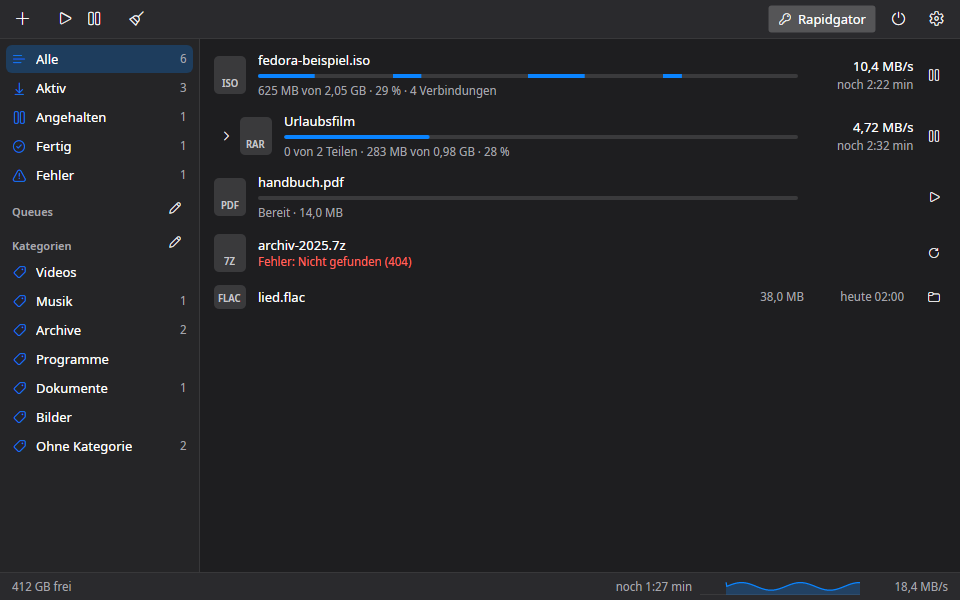

# d6Downloader

d6Downloader ist ein Download-Manager für Linux: Links sammeln, mehrteilige Archive als Paket erkennen,
Dateien mit mehreren Verbindungen laden, anhalten und fortsetzen, danach automatisch entpacken.
Entwickelt und geprüft wird er unter Nobara/Fedora 44 (KDE).



Die Bilder in [docs/screenshots](docs/screenshots) sind ohne Bildschirm gezeichnet, alle Daten darin sind ausgedacht.

Alle Bilder:
[Hauptfenster](docs/screenshots/main-dark.png),
[Hinzufügen](docs/screenshots/add-dark.png),
[Einstellungen](docs/screenshots/settings-dark.png),
[Rapidgator-Anmeldung](docs/screenshots/rapidgator-signin-dark.png),
[Rapidgator-Konto](docs/screenshots/rapidgator-account-dark.png),
[Details](docs/screenshots/x-detail-dark.png),
[Bearbeiten](docs/screenshots/x-edit-dark.png),
[AllDebrid](docs/screenshots/x-debrid-dark.png),
[Hoster](docs/screenshots/x-hosts-dark.png),
[Browser verbinden](docs/screenshots/x-browser-dark.png),
[Kategorien](docs/screenshots/x-categories-dark.png),
[Warteschlangen](docs/screenshots/x-queues-dark.png),
[Passwort](docs/screenshots/x-password-dark.png),
[Nach Abschluss](docs/screenshots/x-after-dark.png).

## Installieren

Ohne sudo (vorher einmalig die Werkzeuge einschließlich `git`, siehe unten).

```
git clone https://github.com/d6njel/d6Downloader.git ~/d6Downloader
cd ~/d6Downloader
./tools/publish.sh
./tools/install.sh
```

Die ausführliche Anleitung für Installation, Browser, Rapidgator, Deinstallation, Datenpfade und Sicherheitsgrenzen steht
in **[DOKUMENTATION.md](DOKUMENTATION.md)**.

## Aktueller Stand

Es ist eine Vorabfassung. **Automatisch geprüft** sind die Programmlogik und die Fenster (ohne Bildschirm, gegen
Attrappen). Die fertige Programmdatei wurde in einer unsichtbaren KDE-Testsitzung gestartet (Browser-Aufruf, `--add`,
zweiter Start, Beenden).

**Noch nicht in Wirklichkeit ausprobiert:**

- Bedienung auf einem echten KDE-Desktop (Maus, Tastatur, Hell/Dunkel, Skalierung), Startmenü-Eintrag
- Tray-Symbol, Benachrichtigungen, Zwischenablage-Überwachung, Drag & Drop aus dem Browser, Dateidialoge,
  „Im Ordner zeigen“, Click'n'Load
- Archive nach dem Entpacken in den Papierkorb verschieben (ab Werk aus, braucht `gio`): mit einem echten Papierkorb
  ungeprüft
- Wachhalten, Herunterfahren, Standby, Autostart
- Browser-Erweiterung in einem echten Firefox und Chrome
- Rapidgator (nur gegen eine Attrappe), AllDebrid (nur gegen eine Attrappe)
- Entpacken: verschlüsseltes RAR mit richtigem Passwort, komprimiertes mehrteiliges RAR 4 bis zum Ergebnis, große echte
  Pakete (Einzelheiten in [DOKUMENTATION.md](DOKUMENTATION.md), Abschnitt 9)

**Entpacken:** ZIP und 7z wie gehabt (eingebaut bzw. 7-Zip), RAR mit `unar`/`lsar`, weil das 7-Zip von Fedora kein RAR
kann. Passwortgeschützte RAR brauchen eine Einstellung, die ab Werk aus ist: `unar` nimmt das Passwort nur auf der
Befehlszeile an, wo es in der Prozessliste sichtbar ist.

**Einschränkungen:**

- Wayland: Das Programm läuft über XWayland. Das Fenster nach vorn zu holen und die Zwischenablage im Hintergrund zu
  lesen, kann das System verhindern.
- Die Skalierung in den Einstellungen wirkt auf das Fenster, nicht auf Menüs, Aufklapplisten und Hinweise.
- Ohne Tray-Symbol beendet das Schließen des Fensters das Programm.

Die offenen Punkte stehen in [DOKUMENTATION.md](DOKUMENTATION.md), Abschnitt 9.

## Installation der Werkzeuge (Fedora/Nobara)

Zum Holen des Quelltexts braucht man `git`, zum Bauen das .NET-10-Entwicklerpaket:

```
sudo dnf install git dotnet-sdk-10.0
```

Zum Entpacken (und damit die Tests dazu laufen) braucht man außerdem die Pakete `7zip`, `bsdtar` und `unar`. Für
die Einstellung, Archive in den Papierkorb zu verschieben, wird `gio` aus `glib2` gebraucht:

```
sudo dnf install 7zip bsdtar unar glib2
```

## Bauen und Testen

Im Projektordner (dort, wo diese Datei liegt):

```
dotnet build d6Downloader.sln
dotnet test d6Downloader.sln
```

Die Oberflächen-Tests (`tests/D6Downloader.UiTests`) öffnen kein Fenster. Neue Bildschirmfotos entstehen mit
`D6_SCREENSHOTS=$PWD/docs/screenshots dotnet test tests/D6Downloader.UiTests`.

`dotnet build` übersetzt den Programmcode. `dotnet test` führt die automatischen Prüfungen aus. Beim ersten Mal lädt
.NET die Testbibliotheken von nuget.org, dafür ist Internet nötig. Die Tests selbst sprechen nur mit dem eigenen
Rechner (`127.0.0.1`) und arbeiten in vorübergehenden Ordnern.

Ohne 7-Zip oder `unar` melden die zugehörigen Tests trotzdem „bestanden“, obwohl sie nichts geprüft haben. Die
RAR-Testdateien stammen aus libarchive, siehe
[tests/D6Downloader.Tests/Fixtures/rar/SOURCE.txt](tests/D6Downloader.Tests/Fixtures/rar/SOURCE.txt).

### Fertige Programmdatei

`tools/publish.sh` legt sie unter `dist/d6downloader-<Version>-linux-x64/` ab: eine Datei `d6downloader`, die ohne
installiertes .NET läuft, daneben `Extension/`, `Licenses/`, `DOKUMENTATION.md`, `d6downloader.png`, `SHA256SUMS` und
die Skripte `install.sh` und `uninstall.sh`. Installiert wird nach `~/.local/lib/d6downloader` mit der Verknüpfung
`~/.local/bin/d6downloader`.

Ohne Fenster: `d6downloader --version`, `d6downloader --add <url>`,
`d6downloader --headless-download <url> --out <ordner>`.

## Rapidgator

Der Knopf **Rapidgator** steht oben im Fenster (auch in den Einstellungen unter „Konten“). Dort gibt man E-Mail und
Passwort ein und sieht danach, wie lange Premium läuft und wie viel Traffic übrig ist. **Die Anbindung wurde nie mit
dem echten Rapidgator ausprobiert**: Grundlage ist die Schnittstellenbeschreibung in
[docs/rapidgator-api-v2.md](docs/rapidgator-api-v2.md) und eine nachgebaute Attrappe auf dem eigenen Rechner. Was die
Beschreibung nicht sagt (abgelaufene Anmeldung, aufgebrauchter Traffic, Captcha), beruht auf Annahmen.

Voraussetzung: ein **Premium-Konto** bei Rapidgator. Konten ohne Premium und Ordner-Links sind vorerst nicht vorgesehen.

So verhält es sich:

1. Im Programm einmal mit E-Mail und Passwort anmelden.
2. Ist beim Konto die Zwei-Faktor-Anmeldung (2FA) eingeschaltet, fragt das Programm nach dem Code. Der Code wird nie
   gespeichert.
3. Man bleibt angemeldet, auch nach einem Neustart, bis man sich selbst abmeldet. Beim Abmelden werden Passwort und
   Anmeldeschlüssel (Token) gelöscht.
4. Rapidgator-Links werden dann wie andere Downloads geladen. Ist auch AllDebrid eingeschaltet, hat das eigene
   Rapidgator-Konto Vorrang.

Wird die Anmeldung abgelehnt (falsches Passwort, falscher Code, Captcha), versucht das Programm es nicht von selbst
erneut, bis man sich neu anmeldet: Zu viele Fehlversuche führen bei Rapidgator zur Sperre der Internetadresse.

Die eigentliche Datei wird zuerst verschlüsselt (HTTPS) angefragt. Klappt das nicht, wird die unverschlüsselte
Adresse benutzt, die Rapidgator liefert; dann kann jemand im selben Netz den Download mitlesen. E-Mail, Passwort und
Token gehen immer nur verschlüsselt über das Netz.

Wo die Daten landen: Passwort und Token verschlüsselt (AES-256-GCM) in den eigenen Dateien des Programms unter
`~/.config/d6downloader`, der Schlüssel dazu in einer getrennten Datei `master.key`, die nur das eigene Benutzerkonto
lesen darf. KWallet wird nicht benutzt.

**Grenze dieser Sicherheit:** Die Verschlüsselung verhindert, dass das Passwort lesbar in einer Datei steht. Sie schützt
**nicht** vor Programmen, die unter dem eigenen Benutzerkonto laufen, vor Administratoren oder vor jemandem, der eine
Kopie (zum Beispiel eine Sicherung) erhält, in der Einstellungen **und** Schlüsseldatei liegen. Wer beides hat, kann das
Passwort entschlüsseln.

Mit eingeschalteter 2FA kann sich das Programm nach Ablauf der Anmeldung nicht allein neu anmelden, dann wird wieder
ein Code gebraucht. Die E-Mail-Adresse steht unverschlüsselt in den Einstellungen.

## Hinweis

d6Downloader ist ein unabhängiges Projekt und gehört nicht zu Rapidgator, AllDebrid, JDownloader oder Apple. Die Namen
dienen nur dazu, die Verträglichkeit zu beschreiben. Nur für erlaubte Inhalte gedacht; für das, was man herunterlädt,
ist man selbst verantwortlich.

## Herkunft und Lizenz

d6Downloader basiert auf [YDownloader](https://github.com/yusa1905/YDownloader) von **Yusa Özbay**. Vielen Dank dafür.
Das Original und diese abgewandelte Fassung stehen unter der MIT-Lizenz, siehe [LICENSE](LICENSE) und
[NOTICE.md](NOTICE.md).
